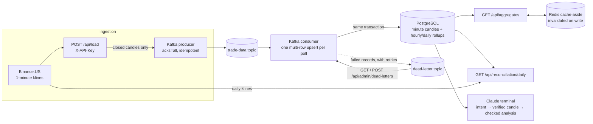

# Market Data Pipeline

A Bitcoin market-data service built on Java 17 and Spring Boot 3.5.11. It fetches one-minute OHLCV candles from Binance.US, writes them to PostgreSQL through a Kafka producer/consumer pipeline, keeps hourly and daily rollups in step with the minute data, reconciles the stored data against the exchange, and serves aggregates through a Redis cache. Every push is tested on GitHub Actions and deployed blue-green to an EC2 host behind nginx.

The project also ships an optional Claude command-line assistant: it extracts BTCUSDT and a date from a question written in English or Chinese, prefers the complete daily data in the database, falls back to Binance.US when the day is incomplete, and has Claude write a short analysis from the verified figures only.

## Results

All figures below were measured on this code; the conditions are stated next to each number.

**Write throughput** (local Docker, PostgreSQL 16 and Kafka 3.9.1, consuming all 527,040 messages of 2024 from the same topic, counting only the write time):

| Consumer version | Time for the year | Throughput |
| --- | --- | --- |
| One row per write | 162.0 s | about 3,250 rows/s |
| One multi-row upsert per poll | about 10.5 s (two runs: 10.7 / 10.4) | about 50,000 rows/s |
| Multi-row upsert plus hourly/daily rollups in the same transaction | 13.6 / 14.3 s (two runs) | about 37,000 rows/s |

Refreshing the rollups costs about 25% of write throughput. In exchange, a year of candles is read from 365 rollup rows instead of being aggregated from half a million minute rows:

| Full-year daily candles, Redis cache miss | Computed from minutes | Read from rollups |
| --- | --- | --- |
| Local Docker, 2024 (366 candles), median of 15 runs, both paths returning identical results | about 487 ms | about 6.7 ms |
| Local Docker, 2024 hourly (8,784 candles), same conditions | about 459 ms | about 21 ms |
| Amazon RDS PostgreSQL 17 (`db.t4g.micro`), 2025 (525,600 minute rows → 365 candles), SQL timed with `psql` from the EC2 host, 2 and 3 runs | 1,516 / 1,565 ms | 2.8 / 1.3 / 1.2 ms |

**Reconciliation** against the exchange's own daily candles: all 366 days of 2024 match field by field, and all 365 days of 2025 on RDS. Before the open-price fix described below, 22 of the 366 days of 2024 had a wrong open. The same endpoint also checks that no daily rollup has drifted from its minute rows: 0 drifted days in both years.

**Deployment** (blue-green behind nginx on EC2, health probe every 0.2 s): 0 failed requests across two deploys of 249 and 221 probed requests, against about 14 s of downtime per deploy before blue-green. Kafka consumption pauses for the two consumer-group rebalances a deploy causes (the new instance joining, the old one leaving): 0.7 to 3.3 s each, 2 to 5.5 s per deploy over seven deploys, read from the broker's group-coordinator log. Messages wait in the topic during the pause; none are lost.

**Tests**: 52 automated tests run on every push (32 unit tests, 20 integration tests, 15 of them on real PostgreSQL, Kafka and Redis through Testcontainers), plus a live evaluation gate for the Claude assistant that runs against the real API before a prompt or model change ships (29 parsing questions, 90% threshold).

## Architecture



Deployment: GitHub Actions runs the tests, pushes the image to GHCR, and through AWS Systems Manager starts it in the idle slot (`app-blue` or `app-green`) on EC2; nginx switches over only after the new slot's health check passes. PostgreSQL is Amazon RDS in the same VPC without public access. Details in [deploy/README.md](deploy/README.md).

## API at a glance

All time parameters are Unix epoch milliseconds.

| Method and path | Purpose |
| --- | --- |
| `GET /messages` | Check that the application responds |
| `POST /api/load/{symbol}/{startTime}/{endTime}` | Fetch the one-minute candles in the range and publish them to Kafka; requires `X-API-Key` |
| `GET /api/aggregates/{period}/{symbol}/{startTime}/{endTime}` | Query aggregates; `period` is `HOURLY` or `DAILY` |
| `GET /api/reconciliation/daily/{symbol}/{from}/{to}` | Compare stored days with the exchange; `from` and `to` are inclusive UTC dates in `YYYY-MM-DD`, at most 366 days, and must be completed days |
| `GET /api/admin/dead-letters?limit=50` | List unprocessed records in the dead-letter topic: failure reason, original topic and offset, replay count, whether it can be replayed; requires `X-API-Key` |
| `POST /api/admin/dead-letters/replay?limit=100` | Send unprocessed dead letters back to the market-data topic; requires `X-API-Key` |
| `GET /actuator/health` | `UP` only when PostgreSQL and Redis are reachable; used by the deploy job |

Load the last five minutes, then read the hourly aggregate and reconcile a day:

```bash
start=$(( $(date +%s) * 1000 - 5 * 60 * 1000 ))
end=$(( $(date +%s) * 1000 ))

curl -X POST -H "X-API-Key: YOUR_RANDOM_KEY" "http://localhost:8080/api/load/BTCUSDT/$start/$end"
curl "http://localhost:8080/api/aggregates/HOURLY/BTCUSDT/$start/$end"
curl "http://localhost:8080/api/reconciliation/daily/BTCUSDT/2024-01-01/2024-12-31"
```

A daily aggregate looks like this (one bucket per day; `complete` is `true` only when all 1,440 minutes are stored and the day has ended):

```json
{
  "bucketStartTime": 1704153600000,
  "symbol": "BTCUSDT",
  "openPrice": 43998.83000000,
  "highPrice": 45889.62000000,
  "lowPrice": 43961.25000000,
  "closePrice": 44953.74000000,
  "volume": 399.57179000,
  "numsOfTrade": 54282,
  "candleCount": 1440,
  "expectedCandleCount": 1440,
  "complete": true
}
```

## How it works

Ingestion:

- Fetches one-minute BTCUSDT candles from Binance.US and stores only closed candles. Whether a candle is closed is judged by the exchange's server time (`/api/v3/time`) minus two seconds, not by the local clock.
- Asynchronous writes through Kafka with an upsert on the `(symbol, open_time)` unique index: redelivered messages never create duplicate rows, and corrected candles overwrite the old values. The producer uses `acks=all` with the Kafka client's idempotent producer.
- The consumer writes in batches: every poll (up to `KAFKA_MAX_POLL_RECORDS` records, default 500) becomes one multi-row upsert. When the same candle appears more than once in a batch, the last version wins.

Aggregation and queries:

- `HOURLY` or `DAILY` aggregates, each bucket reporting its actual and expected minute count and whether it is complete; results are served through a Redis cache-aside layer that is invalidated when new data arrives.
- Hourly and daily candles are pre-aggregated in the `candle_rollup` table, which the consumer refreshes in the same transaction as the minute writes, so the two cannot drift apart if the process dies halfway. Whole buckets are read from the rollups; only the partial buckets at the edges of a range are computed from the minute rows.
- The open, high, low and close of a bucket come only from minutes that traded: the exchange fills a minute without trades with the previous minute's close, so taking the first minute of a day blindly carries yesterday's price into today's open. Reconciliation of the real 2024 data found this (22 of 366 days had a mismatched open before the fix; all 366 matched after it).

Reconciliation:

- The stored minutes, aggregated per UTC day, are compared field by field with the exchange's own daily candle. Only days with all 1,440 minutes are compared; days with fewer are reported as `INCOMPLETE` and skipped. Prices and volumes are compared by value (`1.5` equals `1.50000000`); trade counts must be identical. A difference is reported as `MISMATCH`.
- The daily rollup that queries actually use is compared with the aggregate of the same day's minute rows. A difference is reported as `ROLLUP_MISMATCH`, meaning the rollups have drifted from the minute data.
- The returned `discrepancies` list only the problematic days and their differing fields (`stored` is the database value, `expected` the exchange's value or the value computed from the minutes).

Failure handling:

- Records that fail to be written are retried with exponential backoff and then sent to a dead-letter topic. Records that cannot be deserialized or that the database rejects (for example, a constraint violation) go there without retries. When a batch write fails, the rows are retried one by one to find the offender; the rest of the batch is written normally and the partition is not blocked.
- Dead letters can be listed and replayed through the admin API. Progress is tracked by a dedicated consumer group (`<consumer group>-dlt-replay`), so `GET` lists only what has not been handled yet. A replayable record goes back to the market-data topic with its original key, so it lands in the same partition as the other messages for that symbol; progress is committed only after Kafka acknowledges every send. Every replay increments `x-replay-count`; once a record reaches `KAFKA_DLT_MAX_REPLAYS` (default 3) it is no longer replayed, so one bad message cannot loop forever. Records that cannot be parsed and records over the limit are skipped with the reason reported; they stay in the dead-letter topic until Kafka's retention expires.

Operations:

- The database schema is managed by Flyway migrations that run at application start.
- The load and admin endpoints require an `X-API-Key`, compared as a SHA-256 digest in constant time; when no key is configured they refuse requests instead of letting them through.
- Docker Compose starts the application, a single-node Kafka and Redis for local use; the production stack and the blue-green deploy are described under "Continuous delivery and deployment".

Claude terminal (optional): answers questions about a single completed UTC day. The range and the change are computed in code and handed to the model; the model's analysis goes through deterministic checks (it may only cite the figures it was given, must state the date, UTC, the source and a disclaimer, and must stay under 200 words), and a fixed question set serves as the release gate. See "Using the Claude market terminal".

## Quick start: Docker Compose

Prerequisites:

- Git
- Java 17 (only for running Maven locally)
- Docker Desktop, or Docker Engine with Docker Compose V2
- A reachable PostgreSQL 14+ database
- Local ports `8080` and `9092` free
- Network access to Binance.US; the terminal also needs an Anthropic API key and access to `api.anthropic.com`

PostgreSQL is an external dependency: the service can use Amazon RDS or any PostgreSQL you run yourself. With Amazon RDS, the RDS security group must allow inbound PostgreSQL (`5432`) from your machine's public IP. Do not open it to `0.0.0.0/0` for convenience.

### 1. Clone the repository and configure the environment

Windows PowerShell:

```powershell
git clone https://github.com/chenziliang1/market-data-pipeline.git
Set-Location market-data-pipeline
Copy-Item .env.example .env
```

macOS/Linux:

```bash
git clone https://github.com/chenziliang1/market-data-pipeline.git
cd market-data-pipeline
cp .env.example .env
```

Edit the local `.env` and fill in the real database connection:

```dotenv
SPRING_DATASOURCE_URL=jdbc:postgresql://YOUR_DATABASE_HOST:5432/YOUR_DATABASE
SPRING_DATASOURCE_USERNAME=YOUR_DATABASE_USERNAME
SPRING_DATASOURCE_PASSWORD=YOUR_DATABASE_PASSWORD
APP_API_KEY=YOUR_RANDOM_KEY
```

`APP_API_KEY` is the value the `X-API-Key` header must carry when calling the load and admin endpoints; generate one with `openssl rand -hex 32`. When it is unset those endpoints refuse every request with `503`, so a forgotten setting cannot turn them into public endpoints.

`.env` is ignored by Git and by the Docker build context. Never commit real passwords or API keys.

If PostgreSQL runs on the same machine as Docker, do not use `localhost` as the database host: inside the container, `localhost` is the application container itself. On Windows and macOS use `host.docker.internal`; on Linux use a host address the container can reach.

### 2. Initialize the database

No manual table creation is needed. At start-up, Flyway runs the migrations in [`src/main/resources/db/migration`](src/main/resources/db/migration):

- `V1__trade_data.sql`: the minute-candle table `newtable` and the `(symbol, open_time)` unique index that the `ON CONFLICT` idempotent write relies on.
- `V2__candle_rollups.sql`: the hourly/daily rollup table `candle_rollup`, backfilled from the minute data already stored (527,047 rows took 6.6 s on RDS).

A database that was created before Flyway was introduced (tables exist, no Flyway history table) is baselined at version 0; `V1` uses `IF NOT EXISTS` throughout and changes nothing there, and later migrations run normally. The database user needs permission to create tables.

### 3. Build and start

```bash
docker compose config --quiet
docker compose up --build -d
docker compose ps
docker compose logs -f app
```

The first build downloads dependencies from Docker Hub and Maven Central. The application also needs access to Binance.US and PostgreSQL. The default Compose configuration runs the HTTP service and does not start the interactive Claude terminal.

### 4. Try the HTTP API

The endpoints are listed under "API at a glance". PowerShell equivalent of the examples there:

```powershell
Invoke-RestMethod "http://localhost:8080/messages"

$start = [DateTimeOffset]::UtcNow.AddMinutes(-5).ToUnixTimeMilliseconds()
$end = [DateTimeOffset]::UtcNow.ToUnixTimeMilliseconds()

$headers = @{ "X-API-Key" = "YOUR_RANDOM_KEY" }
Invoke-RestMethod -Method Post -Headers $headers "http://localhost:8080/api/load/BTCUSDT/$start/$end"
Invoke-RestMethod "http://localhost:8080/api/aggregates/HOURLY/BTCUSDT/$start/$end"
Invoke-RestMethod "http://localhost:8080/api/reconciliation/daily/BTCUSDT/2024-01-01/2024-12-31"
```

How the load endpoint behaves:

- Loading writes data and calls the exchange, so it is a `POST` and must carry the correct `X-API-Key`, otherwise it returns `401`. Read-only endpoints (aggregates, reconciliation, health) need no key.
- `symbol` must be 2 to 20 letters or digits; the range must satisfy `startTime < endTime` and may not exceed `BINANCE_MAX_RANGE` (default 366 days). Anything else returns `400`.
- At most `BINANCE_MAX_CONCURRENT_REQUESTS` requests to Binance.US run at once; `429`, `5xx` and network errors are retried with backoff (`Retry-After` is honoured when present).
- The returned count is the number of records Kafka acknowledged, excluding candles skipped because they had not closed. If any batch ultimately fails, the endpoint returns `502` and reports how many records were sent and how many batches failed; the records already sent can be completed safely by requesting the same range again.
- With batch writes the consumer keeps up with the Binance.US fetch when loading a whole year locally: by the time the endpoint returns (about 27 s) everything is in the database, where it used to take about 190 s. With a remote database such as RDS every statement pays a network round trip, so the numbers differ.

For every bucket of an aggregate, `candleCount` is the number of minutes actually stored, `expectedCandleCount` the number of minutes the bucket should have within the requested range, and `complete` is `true` only when the two are equal and the bucket has ended. Buckets with no data at all are not returned.

The count returned by the load endpoint is the number of records sent to Kafka; whether they reached the database should be confirmed in the application logs or in PostgreSQL:

```sql
SELECT *
FROM newtable
WHERE symbol = 'BTCUSDT'
ORDER BY open_time DESC
LIMIT 10;
```

### 5. Stop

```bash
docker compose down
```

This Compose setup is meant for local development and demos: Redis is only a rebuildable cache; Kafka is a single node without authentication or a persistent volume, so messages and offsets may be lost when the container is removed. Business data lives in the external PostgreSQL.

## Using the Claude market terminal

The terminal currently supports `BTCUSDT` only, and every question must refer to one completed UTC day. Relative dates such as "yesterday" are also interpreted in UTC, and a question may not exceed 2,000 characters.

```text
natural-language question -> Claude extracts BTCUSDT and the date
                                        |
                                        v
complete minute data in the database -> daily aggregate ----+
database unavailable or day incomplete -> Binance.US daily  |
                                                            v
                                            Claude market analysis -> deterministic checks
```

### 1. Add the optional settings

Add to the local `.env`:

```dotenv
ANTHROPIC_API_KEY=YOUR_ANTHROPIC_API_KEY
CLAUDE_API_URL=https://api.anthropic.com/v1/messages
TERMINAL_CHAT_ENABLED=true
BINANCE_API_BASE_URL=https://api.binance.us
```

Everything except `ANTHROPIC_API_KEY` and `TERMINAL_CHAT_ENABLED=true` already has the defaults shown. The default model is Claude Sonnet (see `claude.model` in `application.properties`); override it with `CLAUDE_MODEL`. Questions are sent to Anthropic's API, so do not type passwords, keys or other sensitive information into them.

### 2. Start the interactive application

A plain `docker compose up -d` neither passes the terminal settings to the container nor suits interactive input. Use the one-off container command below; it builds the application, starts the dependencies, reads `.env`, and removes the application container on exit:

```bash
docker compose run --rm --build --env-from-file .env -e TERMINAL_CHAT_ENABLED=true app
```

To run on the host instead, start the dependencies first and run `./mvnw spring-boot:run` from the project root (`.\mvnw.cmd spring-boot:run` on Windows), making sure the process can read the settings in `.env`.

Once it is running, try:

```text
Show me Bitcoin's open, high, low and close for January 2, 2024 and comment on the volatility
```

Type `exit` or `quit` to leave the question loop; Spring Boot keeps running until you press `Ctrl+C`.

For each question, the application uses the database's daily aggregate only when the database holds exactly the 1,440 minute rows of that UTC day; otherwise it falls back to the Binance.US daily endpoint. The fallback result is used for that question only and is never written back to the database. Claude receives the original question, the verified candle, and the range, the change and their percentages of the open as computed by the application, and writes its analysis from those alone; the result is for reference only and is not investment advice. After the answer comes back, `AnalysisGuard` runs deterministic checks: every price and percentage in the text must be a value the application supplied (rounding allowed), the date, UTC and the data source must be stated, the "not investment advice" reminder must be present, and the text must stay under 200 words. When a check fails, the terminal still prints the analysis but lists the problems and tells the user to rely on the market data only.

Question parsing uses structured output on the Anthropic Messages API (`output_config.format` of type `json_schema`): the application supplies a JSON schema with the fields `symbol`, `date` and `error`, and the model's answer is guaranteed to match it, so nothing has to be cut out of free text. The code then validates the symbol allow-list and the date independently; a question about "today" is rejected even if the model treats it as a valid date. The analysis step is an ordinary text reply.

## Evaluating the assistant (release gate)

`ClaudeLiveEvalTest` runs a fixed question set against the real API and acts as the release gate after a prompt change, a model change or an upgrade. It runs only when `ANTHROPIC_API_KEY` is set; CI has no such variable, so it never runs there. One run makes about 39 Sonnet calls.

```bash
ANTHROPIC_API_KEY=YOUR_ANTHROPIC_API_KEY ./mvnw test -Dtest=ClaudeLiveEvalTest -Dsurefire.failIfNoSpecifiedTests=false
```

- **Question parsing** (`src/test/resources/eval/intent-questions.json`, 29 questions): explicit dates in English and Chinese, spellings such as `2024/01/02` and `2024.1.2`, relative dates such as yesterday, the day before yesterday and last year, and the BTCUSDT default when no asset is named; plus the cases that must be refused: today, the future, date ranges, no date, other assets such as Ethereum, invalid dates, and two prompt injections that try to rewrite the rules. Every question must either yield the expected `symbol` and date or be refused when refusal is expected.
- **Analysis** (`src/test/resources/eval/analysis-days.json`, 5 real trading days × 2 phrasings): every reply must pass all of `AnalysisGuard`'s deterministic checks.
- The test fails when a pass rate falls below its threshold (90% for both by default; adjustable with `-Deval.intent.threshold` and `-Deval.analysis.threshold`). Per-question results go to `target/eval-report.md`, with the analysis texts folded into the report.

## Running the tests

Windows:

```powershell
.\mvnw.cmd test
```

macOS/Linux:

```bash
./mvnw test
```

There are three kinds of tests, 53 in all:

- 32 unit tests: Binance response mapping, filtering of unclosed candles by the exchange clock, retries and input validation, Kafka send failures, reconciliation classification and validation, the API-key filter and the load endpoint, the Claude request/response handling (structured-output request body, headers, `502` when the reply is not JSON, code-side rejection of "today" even when the model accepts it), the deterministic analysis checks (metric computation, only supplied figures may be cited, missing date/timezone/source/disclaimer, over-long text) and the database completeness condition.
- 20 integration tests. Five start the Spring context with the Kafka listener and Flyway switched off (context loading, the load endpoint through MockMvc with the exchange mocked). The other 15 (`PipelineIntegrationTest`) use Testcontainers to start real Kafka, PostgreSQL and Redis, let Flyway create the schema, and cover rollups staying consistent with the minute data after corrections and out-of-order delivery, unaligned query ranges counting only the minutes inside the range, idempotent redelivery, corrected candles overwriting old values, hourly aggregation under out-of-order delivery, bucket completeness, cache TTLs, cache invalidation on new writes, malformed messages going to the dead-letter topic without blocking later messages, a row rejected by the database going to the dead-letter topic while the rest of its batch is written, a correction in the same batch overwriting the original, reconciliation catching both a deliberately corrupted minute candle and the rollup that drifted because of it, and dead-letter listing and replay (replayable records are written, unparseable and over-limit records are skipped, processed records no longer appear).
- 1 release gate (`ClaudeLiveEvalTest`): calls the real API, needs `ANTHROPIC_API_KEY`, and is skipped without it; see "Evaluating the assistant".

The Testcontainers tests need Docker on the machine; without Docker they are skipped rather than failed. The interactive terminal loop and the full Claude fallback path are not yet covered.

Every push and pull request runs the whole suite through GitHub Actions (`.github/workflows/ci.yml`): 52 tests, with the release gate skipped.

## Continuous delivery and deployment

On every push, GitHub Actions (`.github/workflows/ci.yml`):

1. runs all tests;
2. once they pass, builds the Docker image and pushes it to `ghcr.io/chenziliang1/market-data-pipeline`, tagged `sha-<commit>` and with the branch name;
3. optionally, through AWS Systems Manager, switches the EC2 host to that commit's image blue-green style: the new version starts in the idle slot, nginx switches over only after `/actuator/health` passes (PostgreSQL and Redis both reachable), and the old version is then stopped gracefully. If the new version never becomes healthy, the job fails and the old version keeps serving.

Measured on EC2 with a health probe every 0.2 s, two deploys of 249 and 221 probed requests had no failed request; before blue-green, every deploy meant about 14 s of downtime. On the Kafka side, each deploy causes two consumer-group rebalances (the new instance joins, then the old one leaves after an explicit `LeaveGroup` on graceful shutdown); over seven deploys each rebalance paused consumption for 0.7 to 3.3 s according to the broker's group-coordinator log. Messages wait in the topic during the pause.

Step 3 is off by default and needs a one-time AWS setup (OIDC role, Docker and database settings on EC2); see [deploy/README.md](deploy/README.md). Deployment uses no SSH, and GitHub stores neither AWS keys nor the database password.

## Configuration reference

| Variable | Required | Default | Description |
| --- | --- | --- | --- |
| `SPRING_DATASOURCE_URL` | yes | none | PostgreSQL JDBC URL |
| `SPRING_DATASOURCE_USERNAME` | yes | none | PostgreSQL user |
| `SPRING_DATASOURCE_PASSWORD` | yes | none | PostgreSQL password |
| `KAFKA_BOOTSTRAP_SERVERS` | no | `localhost:9092` | Kafka broker; `kafka:29092` inside Compose |
| `KAFKA_TRADE_DATA_TOPIC` | no | `trade-data` | Market-data topic |
| `KAFKA_CONSUMER_GROUP_ID` | no | `demo-trade-data-consumer` | Kafka consumer group |
| `KAFKA_TRADE_DATA_DLT_TOPIC` | no | `<market-data topic>.DLT` | Dead-letter topic |
| `KAFKA_MAX_POLL_RECORDS` | no | `500` | Maximum records per poll, and therefore rows per multi-row upsert |
| `KAFKA_RETRY_MAX_RETRIES` | no | `3` | Retries after a failed write before the record goes to the dead-letter topic |
| `KAFKA_RETRY_INITIAL_INTERVAL` | no | `PT1S` | Wait before the first retry; doubles each time |
| `KAFKA_DLT_MAX_REPLAYS` | no | `3` | How many times one dead letter may be replayed |
| `REDIS_HOST` | no | `localhost` | Redis host; `redis` inside Compose |
| `REDIS_PORT` | no | `6379` | Redis port |
| `BINANCE_API_BASE_URL` | no | `https://api.binance.us` | Binance.US API root used for minute fetches and the daily fallback |
| `BINANCE_MAX_RANGE` | no | `P366D` | Maximum range of one load request |
| `BINANCE_MAX_CONCURRENT_REQUESTS` | no | `4` | Maximum concurrent requests to Binance.US |
| `BINANCE_MAX_ATTEMPTS` | no | `3` | Maximum attempts per batch, including the first |
| `BINANCE_RETRY_BACKOFF` | no | `PT1S` | Initial retry wait; doubles each time |
| `AGGREGATE_CACHE_CLOSED_TTL` | no | `PT1H` | Cache TTL for aggregates whose range has ended |
| `AGGREGATE_CACHE_OPEN_TTL` | no | `PT1M` | Cache TTL for aggregates whose range extends past now |
| `APP_API_KEY` | for load and admin calls | empty | Value of the `X-API-Key` header; when empty those endpoints return `503` |
| `ANTHROPIC_API_KEY` | terminal only | empty | Anthropic API key |
| `CLAUDE_API_URL` | no | `https://api.anthropic.com/v1/messages` | Anthropic Messages API endpoint |
| `CLAUDE_API_VERSION` | no | `2023-06-01` | Value of the `anthropic-version` header |
| `CLAUDE_MODEL` | no | Claude Sonnet (see `application.properties`) | Claude model name |
| `TERMINAL_CHAT_ENABLED` | no | `false` | Whether to start the interactive terminal |

Kafka producer settings not listed here keep the Kafka client's defaults: `enable.idempotence=true`, `max.in.flight.requests.per.connection=5`, unlimited retries within `delivery.timeout.ms=120000`; the project sets `acks=all` explicitly.

## About Jenkins

This repository has no Jenkinsfile. The Jenkins work done earlier was a separate Maven/Hello World deployment exercise targeting a CentOS virtual machine on a private network, not this project's production path on AWS. The reproducible deployment of this repository is the GitHub Actions flow described above and the Docker Compose flow for local use.
